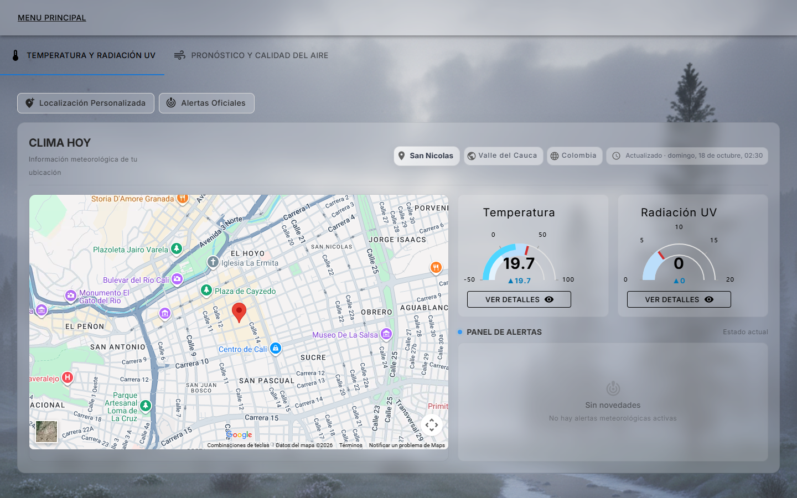
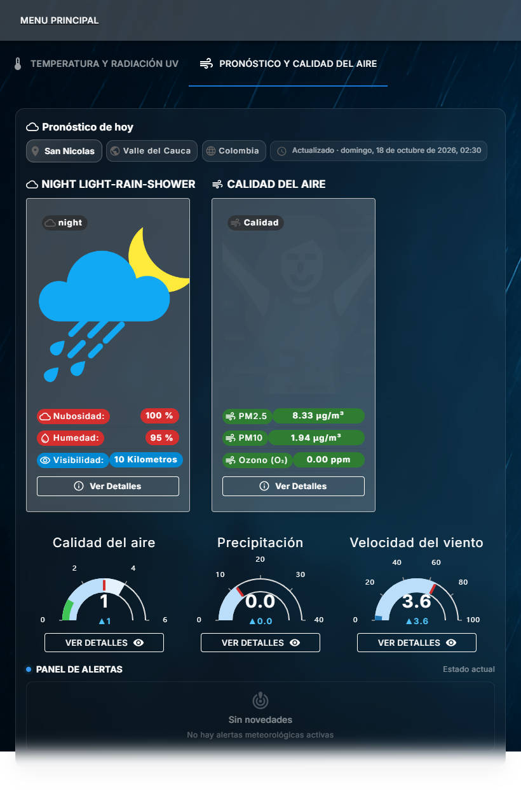
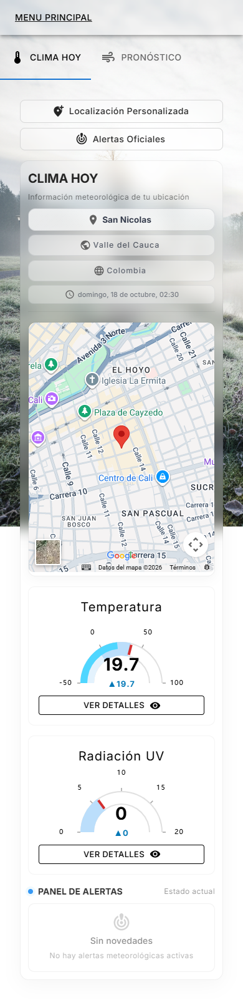

# MiClimaHoy

Aplicación web que muestra el clima de tu ubicación con recomendaciones: temperatura, radiación UV, pronóstico, calidad del aire y alertas meteorológicas oficiales. El fondo de pantalla cambia según la temperatura.

**Demo:** https://mi-clima-hoy-main.vercel.app/NewVersion



| Tablet · Pronóstico y calidad del aire | Celular · Clima de hoy |
|---|---|
|  |  |

## Funcionalidades

- **Clima actual** de tu ubicación con mapa, temperatura y radiación UV en medidores con el rango recomendado.
- **Pronóstico y calidad del aire:** nubosidad, humedad, visibilidad, PM2.5, PM10, ozono y otros contaminantes, precipitación y viento.
- **Alertas oficiales** de entidades gubernamentales (por ahora Colombia) y panel de alertas por métrica.
- **Localización personalizada:** consulta el clima de cualquier ciudad del mundo (250 países, ~150.000 ciudades).
- **Fondo dinámico** según la temperatura, con letras claras u oscuras según el fondo.
- Diseño responsivo para celular, tablet y escritorio.

## Arquitectura

```
Navegador (React)  ──►  Mi-Clima-Hoy-Backend (Vercel)  ──►  WeatherAPI, fuentes de alertas
       │
       └── public/datos/  países y ciudades estáticos, se descargan solo cuando se necesitan
```

- **Frontend (este repositorio):** React 18, Material UI 7, ECharts (medidores y gráficos), React Router. Desplegado en Vercel.
- **Backend:** [Mi-Clima-Hoy-Backend](https://github.com/jaoviedo3490/Mi-Clima-Hoy-Backend), que consulta los servicios de clima y arma las métricas, alertas y recomendaciones.

### Decisiones técnicas

- **Carga bajo demanda de países y ciudades.** El catálogo original era un JSON de 28 MB importado en el código, que se descargaba completo al abrir la app. `scripts/dividir-paises-ciudades.js` lo divide en `public/datos/paises.json` (2 KB comprimido) y un archivo por país que se pide solo al escogerlo (Colombia: 15 KB). El JavaScript inicial pasó de **2,9 MB a 0,2 MB comprimido**.
- **Medidores en ECharts en lugar de Plotly.** Plotly pesaba 1,3 MB comprimido solo para dos medidores; ECharts ya estaba en la app. `medidorEcharts.js` reproduce el mismo diseño (rango, franjas, límite recomendado, diferencia). Abrir la pantalla principal pasó de **~4,2 MB a ~0,6 MB** comprimido.
- **Ubicación aproximada y recordada.** El clima no necesita la ubicación exacta: se redondea a ~1 km, se guarda entre visitas y se usa de inmediato al abrir la app; la ubicación actual se confirma en segundo plano y solo se vuelve a pedir el clima si la persona se movió más de 5 km.
- **Lógica de negocio en funciones puras con pruebas** (`src/servicios/`, `medidorEcharts.js`): fondo según la temperatura, ubicación, catálogos y medidores.

## Estructura

```
src/
  servicios/                 lógica pura: ubicación, catálogos, fondo por temperatura (con pruebas)
  componentes/Migration/     versión actual de la interfaz (ruta /NewVersion)
    ComponentsMainMenu/      pestañas de clima actual y pronóstico
    Graphics/                medidores y gráficos (medidorEcharts.js + pruebas)
  Context/                   estado compartido
public/datos/                países y ciudades generados por el script
scripts/                     utilidades (división del catálogo de ciudades)
datos-fuente/                catálogo original de países y ciudades
```

## Cómo correrlo

```bash
npm install
npm start          # http://localhost:3000/NewVersion
npm test           # pruebas unitarias
npm run build      # build de producción
```

Si se actualiza `datos-fuente/countries_cities.json`, regenerar los archivos con `node scripts/dividir-paises-ciudades.js`.

## Pendiente

- Mover a `Mi-Clima-Hoy-Backend` las llamadas que todavía se hacen desde el navegador con clave (WeatherAPI en la versión anterior y la búsqueda de LangSearch), para que ninguna clave viaje en el JavaScript público.
- Dividir `MainMenu.jsx` y `Pronostics.jsx` en componentes más pequeños.
- Pasar el árbol de Pronósticos de Plotly a ECharts y retirar Plotly.
- Retirar la versión anterior de la interfaz (ruta `/`).
